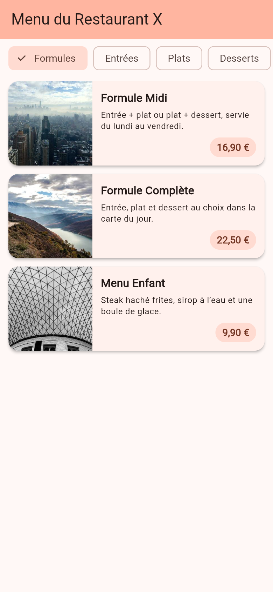
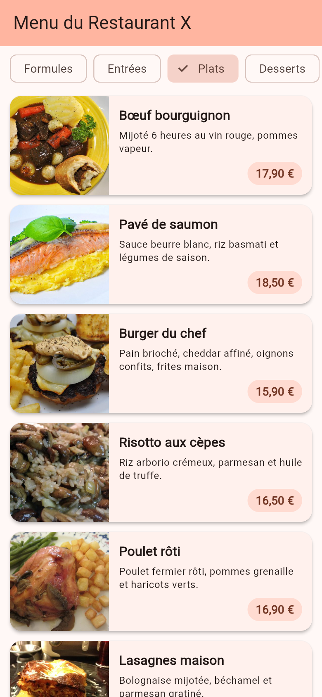
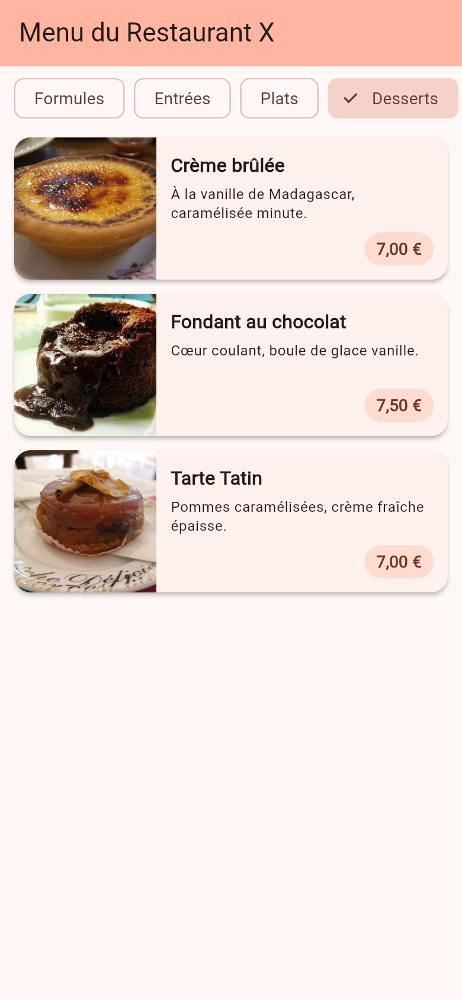
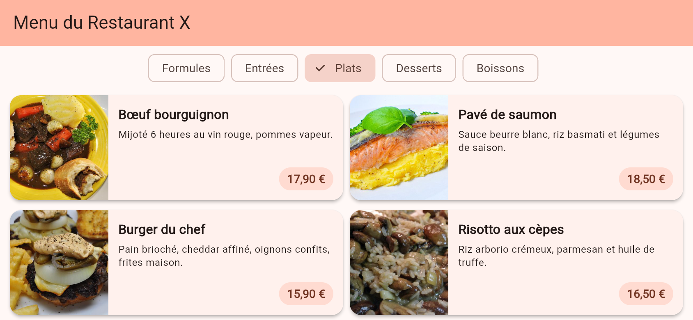

# Menu du Restaurant X

Application Flutter qui affiche la carte d'un restaurant par catégorie
(Formules, Entrées, Plats, Desserts, Boissons). Chaque plat est présenté
sous forme de carte avec image, nom, description et prix.

## Fonctionnalités

- **Catégories scrollables** : barre horizontale d'étiquettes (`ChoiceChip`)
  dans un `SingleChildScrollView`, utilisable même sur un écran étroit.
- **Cartes réutilisables** : un seul widget `PlatCard` pour tous les plats,
  sans duplication de code.
- **Sélection** : la catégorie active est mise en évidence et filtre la liste
  (« Formules » par défaut).
- **Responsive portrait / paysage** : `LayoutBuilder` affiche une liste en
  portrait et une grille de 2 ou 3 colonnes sur un écran large.
- **Animation** : transition en fondu (`AnimatedSwitcher`) au changement de
  catégorie.
- **Images robustes** : chargement réseau avec repli sur un emoji si l'image
  ne charge pas (hors ligne).

## Structure du code

Tout le code est dans [`lib/main.dart`](lib/main.dart) :

| Élément | Rôle |
| --- | --- |
| `Plat` | Modèle de données immuable (nom, description, prix, catégorie, emoji, image). |
| `CategorieBar` | Barre horizontale des catégories, signale la sélection via `onSelect`. |
| `PlatsListe` | Liste (portrait) ou grille (paysage) des plats de la catégorie, construite à la demande. |
| `PlatCard` | Carte réutilisable d'un plat : image à gauche, texte et prix à droite. |
| `PlatImage` | Image réseau avec emoji de repli pendant le chargement ou en cas d'erreur. |

`MenuPage` (StatefulWidget) garde la catégorie sélectionnée et assemble ces
composants.

## Captures d'écran

| Formules (portrait) | Plats (portrait) | Desserts (portrait) |
| --- | --- | --- |
|  |  |  |

Paysage, catégorie Plats (affichage en grille) :



## Vidéo de démo

- [demo.mp4](docs/demo.mp4)
- [demo.webm](docs/demo.webm)

## Lancer le projet

```bash
flutter pub get
flutter run -d chrome
```

## Tests

```bash
flutter test
```

Les tests vérifient que les 5 catégories s'affichent, que « Formules » est
sélectionnée par défaut et qu'un tap sur « Desserts » affiche « Crème brûlée »
et masque « Formule Midi ».
